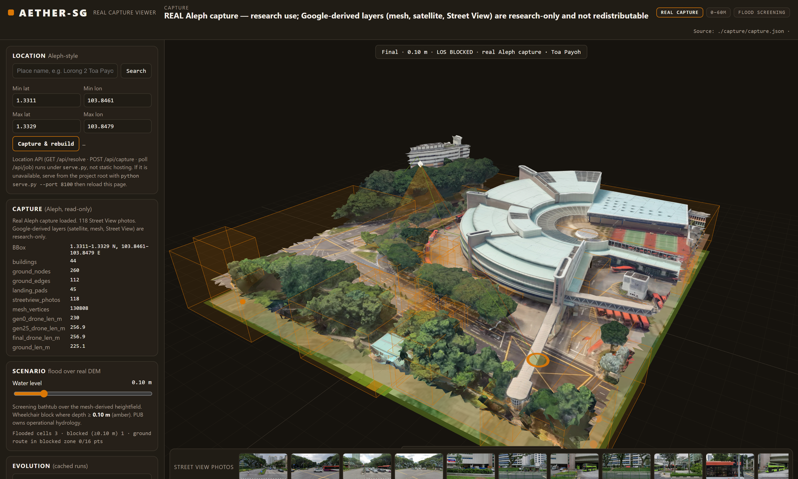
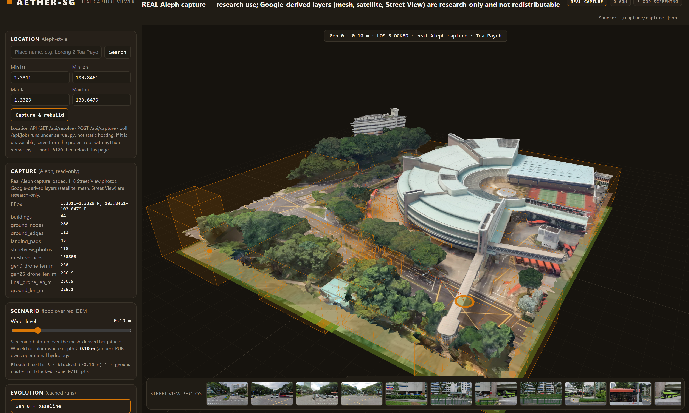
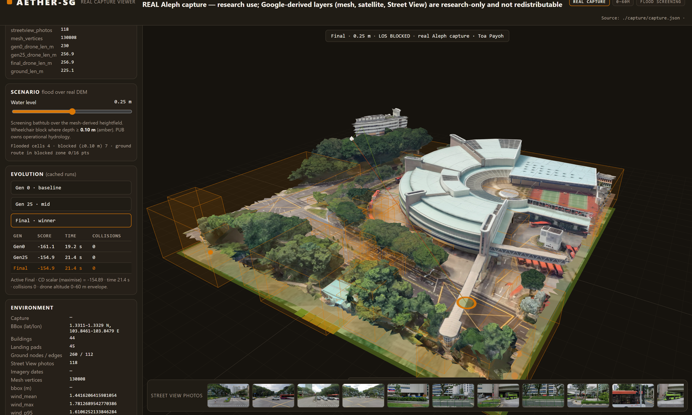
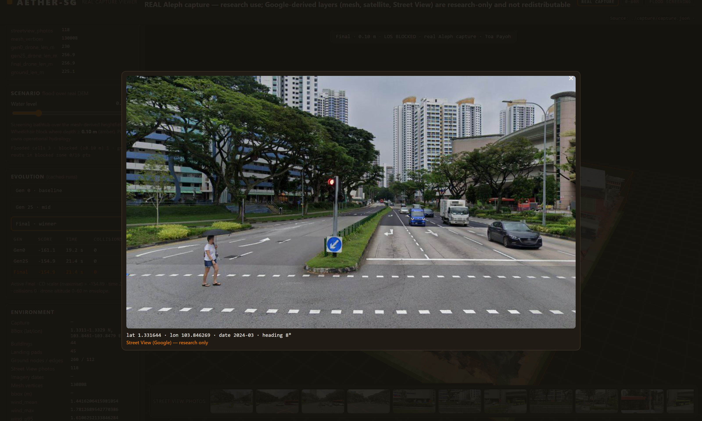

# AETHER-SG — Real-capture MVP

Autonomous Emergency Trajectory, HADR & Evacuation Twin for dense urban
canyons (Singapore). Concept: [Admin/Idea.md](Admin/Idea.md).
Evidence base: [Admin/Research-AETHER-SG.md](Admin/Research-AETHER-SG.md).

Everything below runs on the REAL Aleph capture
`captures/aleph-20261119T022946Z-1upsr2v9` (mesh.glb 7.5 MB, map.osm,
terrain.tif 512x512, satellite.png, 118 Street View photos). OSM holds
only a handful of building tags in this bbox, so buildings are derived
from the mesh.glb heightfield, never from OSM building tags. Google
derived layers (satellite, 3D mesh, Street View) are research-only.

Drone envelope is 0-60 m. Flood is a screening tensor (PUB owns
operational hydrology). Routes are advisory, not for navigation.

---

## Tactical 3D Visualizer


*AETHER-SG Tactical Visualizer in Toa Payoh, Singapore: rendering real 3D building photogrammetry, mesh-derived obstacle heightfields, 0–60 m low-altitude drone trajectory corridors, wheelchair evacuation ground paths, and street-level photo audits.*

### Visualizer Features & Scenarios

| 1. Evolution Baseline (Gen 0) | 2. Micro-Flood Screening |
|:---:|:---:|
|  |  |
| *Baseline seed trajectory vs evolved collision-free route* | *Water accumulation with wheelchair blockage markers (depth ≥0.10 m)* |

| 3. Street-Level Infrastructure Audit |
|:---:|
|  |
| *High-resolution panorama inspection for curb cuts, linkways, and obstacles* |

---

## Layout

- `src/aether/aleph_ingest.py` — `alephgeo` CLI wrapper (resolve,
  streetview single/street, satellite, capture, resume, export,
  dashboard). Google layers research-only.
- `src/aether/real_slice.py` — real 200x200 m slice from one capture:
  mesh heightfield buildings, bbox-cropped terrain DEM, OSM
  pedestrian graph, landing pads, photo audit points.
- `src/aether/evaluator.py` — voxel SDF (0-60 m), GNSS shadow proxy,
  flood screening tensor, single-scalar `score_path` (CD contract).
- `src/aether/routing.py` — wheelchair ground A* (blocks flood
  >= 0.10 m, slope > 1:12, width < 1.2 m) + drone 3D A*.
- `src/aether/evolve.py` — local evolutionary search over heuristic
  weights, held-out check, leakage guard (stand-in for CD).
- `scripts/run_real.py` — real-only pipeline: real slice -> SDF /
  shadow / flood -> local evolution on the real slice (Gen0 / Gen25 /
  final drone routes, wheelchair ground route) -> viewer bundle.
- `scripts/aleph.py` — JSON CLI over `aleph_ingest` (one subcommand
  per wrapper).
- `scripts/capture_screenshots.py` — Playwright headless capture tool
  generating high-resolution visualizer documentation screenshots.
- `viewer/` — Three.js tactical viewer, real capture only
  (`./capture/capture.json` + indexed mesh / satellite / photos).
- `cd/aether_evolve.ipynb` — CD notebook; see [cd/README-CD.md](cd/README-CD.md).
- `tests/test_real_capture.py` — pytest on the real capture
  (buildings, graph, DEM, drone + ground routes, bundle schema,
  viewer hygiene). Skips only when the capture folder is absent.

## Run (real-only flow)

1. Capture the area with `alephgeo` (Toa Payoh polygon, all sources):

```powershell
cd "C:\VSCode Folder\Ather-SG"
.\.venv\Scripts\alephgeo.exe capture create --bbox 1.3311 103.8461 1.3329 103.8479 --sources streetview satellite osm terrain mesh --yes --json
```

For an already-captured folder, resume or rebuild offline:

```powershell
.\.venv\Scripts\alephgeo.exe capture resume captures\aleph-20261119T022946Z-1upsr2v9 --yes --json
.\.venv\Scripts\alephgeo.exe capture export captures\aleph-20261119T022946Z-1upsr2v9 --json
```

2. Build the viewer bundle from the real slice:

```powershell
.\.venv\Scripts\python.exe scripts/run_real.py
```

This writes `viewer/capture/capture.json` (extended with buildings,
dem, dronePaths, groundPath, metrics) and refreshes the indexed
`mesh.glb` / `satellite.png` copies the viewer loads.

3. Serve the project root and open the viewer:

```powershell
.\.venv\Scripts\python.exe scripts/serve.py --port 8100
```

Then open http://127.0.0.1:8100/viewer/ in a browser. The server is
rooted at the project so `viewer/capture/` assets and `captures/`
photos resolve. Heightfield buildings, DEM, routes and the photo
filmstrip all come from the capture on disk.

Aleph features are wrapped in `src/aether/aleph_ingest.py` with CLI
`scripts/aleph.py`; see [docs/ALEPH-FEATURES.md](docs/ALEPH-FEATURES.md).
Aleph's own dashboard: `.\.venv\Scripts\alephgeo.exe dashboard -o captures --port 8101`.

## Viewer design

Warm charcoal ops console (no glare): background #16130E, panels
#201C15 / #262019, text #F3EFE8, muted #A79E91, accent amber #D97706,
olive #6B8E23, rust #C2410C. Flood and blocked cells read amber, GNSS
shadow reads amber-to-rust, drone gens read rust / amber / olive, the
ground route reads off-white and photos amber. One typeface pair
(Segoe UI / Consolas) keeps tabular metrics aligned. three.js loads
from CDN for convenience; the airgap build vendors it locally
(see the importmap note in `viewer/index.html`).

## Tests

```powershell
.\.venv\Scripts\python.exe -m pytest tests -q
```

## Computational Discovery

The CD notebook (`cd/aether_evolve.ipynb`, built by
`cd/make_notebook.py`) keeps the single-scalar contract from the
research report: maximise one metric in the hidden scoring cell,
solvers plugged into the setup / mutable / scoring split. Staged
files, the 25-minute test run, SHORT (~6 h) vs LONG (~24 h) cloud
search, TTA sign-off timing and the honest latency wording all live
in [cd/README-CD.md](cd/README-CD.md). Do not present the stage
replay as a live search; the heavy search runs in the cloud before
the mission and the chosen solver replays offline.
